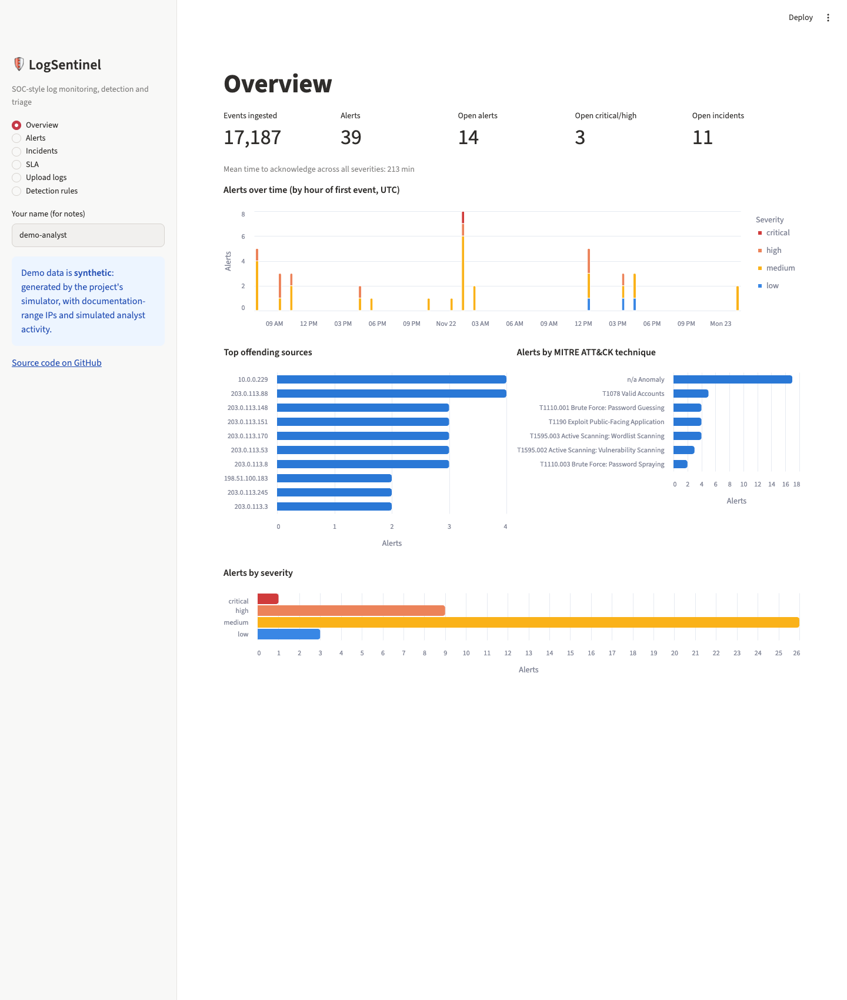
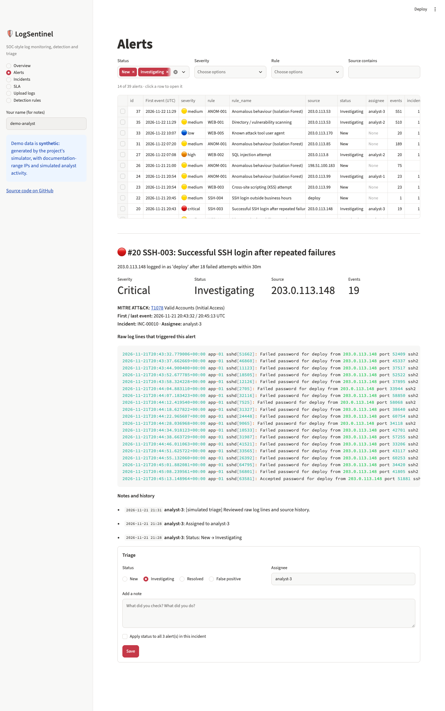
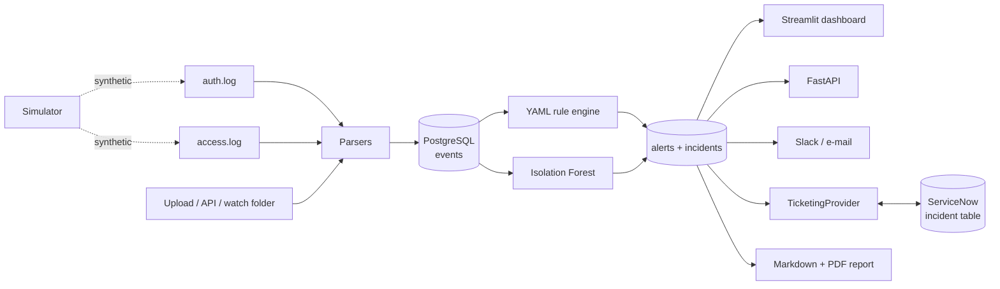
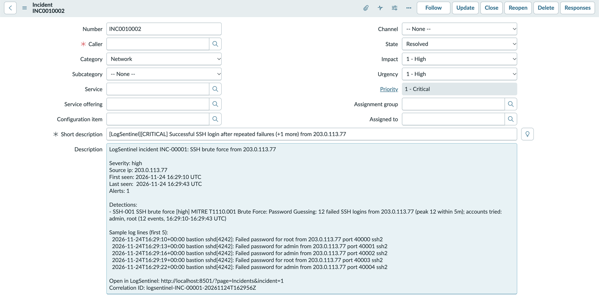
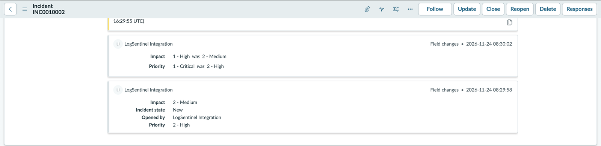
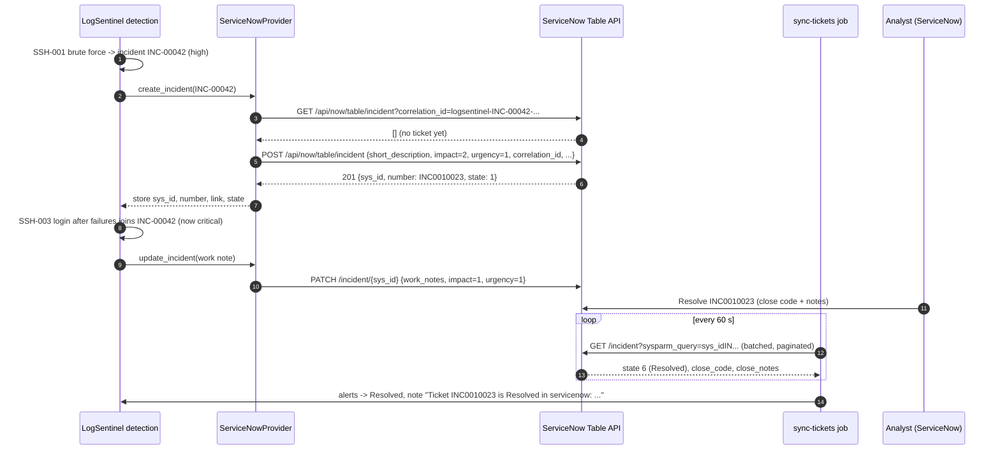

# LogSentinel

[](https://github.com/VydyaP/logsentinel/actions/workflows/ci.yml)


**A small Security Operations Center (SOC) tool that watches SSH and web server logs, detects attacks with MITRE ATT&CK-mapped rules and an anomaly model, opens and tracks incidents in ServiceNow, and helps an analyst triage, track SLAs and write incident reports.**

**Live demo:** [https://vydyap-logsentinel-dashboardapp-wagokk.streamlit.app/](https://vydyap-logsentinel-dashboardapp-wagokk.streamlit.app/) · [Design](docs/DESIGN.md) · [Evaluation](docs/EVALUATION.md) · [Runbooks](docs/runbooks/README.md)

> The demo data is **synthetic**, generated by the included simulator. It uses only
> reserved documentation IP ranges and made-up user names. A small **real** public
> SSH log ([loghub](data/real/README.md)) is included too.



## What it does

| Step | How |
|---|---|
| **Ingest** | Parses Linux SSH `auth.log` (classic and RFC 3339 syslog) and Nginx/Apache *combined* access logs. Upload in the UI, `POST /ingest`, the CLI, or a **watch folder** that tails files like `tail -f`. Everything lands in one normalised PostgreSQL `events` table. Re-ingesting a file adds nothing. |
| **Detect** | 9 **YAML rules** (thresholds, distinct counts, sequences) mapped to MITRE ATT&CK, plus an **Isolation Forest** over per-IP hourly behaviour. |
| **Alert** | Alerts are deduplicated and **grouped into incidents** per source. High/critical alerts can go to **Slack** and/or **e-mail**. |
| **Triage** | Status (New / Investigating / Resolved / False positive), assignee, notes with an audit trail, **time-to-acknowledge and time-to-resolve** against per-severity SLA targets. |
| **Report** | One click (or `logsentinel report <id>`) produces a **Markdown + PDF incident report**: summary, timeline, affected assets, indicators, MITRE mapping, recommended actions, evidence. |
| **Respond** | A [runbook](docs/runbooks/README.md) per detection: what it means, how to verify, contain and close. |
| **Ticket** | High/critical incidents **open a ServiceNow incident** through the REST Table API (deduplicated by correlation ID), new alerts become work notes, and a sync job closes alerts when the ticket is resolved. [Details](#servicenow-integration). Pluggable `TicketingProvider` interface; `noop` by default. |

<table>
<tr>
<td></td>
<td></td>
</tr>
<tr>
<td align="center">Alert detail: raw evidence, MITRE link, notes, triage</td>
<td align="center">SLA: mean time to acknowledge/resolve and breaches</td>
</tr>
</table>

## Architecture



Python 3.11+, pandas, scikit-learn, SQLAlchemy 2 + Alembic, PostgreSQL, FastAPI,
Streamlit, Jinja2, fpdf2 · pytest, ruff, mypy, pre-commit, gitleaks · Docker
Compose · GitHub Actions. Details and trade-offs: [docs/DESIGN.md](docs/DESIGN.md).

## Detections

| Rule | Detects | Severity | MITRE ATT&CK |
|---|---|---|---|
| SSH-001 | SSH brute force: >=10 failed logins from one IP in 5 min | High | [T1110.001](https://attack.mitre.org/techniques/T1110/001/) Password Guessing |
| SSH-002 | Password spraying: >=8 different usernames from one IP in 30 min | High | [T1110.003](https://attack.mitre.org/techniques/T1110/003/) Password Spraying |
| SSH-003 | Successful login after >=5 failures from the same IP | **Critical** | [T1078](https://attack.mitre.org/techniques/T1078/) Valid Accounts |
| SSH-004 | Successful login outside 07:00-21:00 IST | Medium | [T1078](https://attack.mitre.org/techniques/T1078/) Valid Accounts |
| WEB-001 | Directory/vulnerability scanning: >=25 403/404s in 2 min | Medium | [T1595.003](https://attack.mitre.org/techniques/T1595/003/) Wordlist Scanning |
| WEB-002 | SQL injection patterns in the (decoded) URL | High | [T1190](https://attack.mitre.org/techniques/T1190/) Exploit Public-Facing Application |
| WEB-003 | Cross-site scripting patterns | Medium | [T1190](https://attack.mitre.org/techniques/T1190/) Exploit Public-Facing Application |
| WEB-004 | Path traversal (`../`, `/etc/passwd`, double-encoded) | High | [T1190](https://attack.mitre.org/techniques/T1190/) Exploit Public-Facing Application |
| WEB-005 | Known attack-tool user agent (Nikto, sqlmap, ...) | Low | [T1595.002](https://attack.mitre.org/techniques/T1595/002/) Vulnerability Scanning |
| ANOM-001 | Isolation Forest: an IP-hour unlike the rest | Medium | n/a (behavioural) |

## How well does it work?

Measured with `logsentinel evaluate` on 2 days of synthetic traffic (17,187
events, 13 labelled attacks). The normal traffic deliberately includes things
that *look* suspicious but are not attacks (on-call logins at night, a nightly
broken-link checker, a search crawler). Full breakdown: [docs/EVALUATION.md](docs/EVALUATION.md).

| Detector | Precision | Recall |
|---|---|---|
| YAML rules (alert precision / attack recall) | **82%** (18 of 22 alerts are real attacks) | **92%** (12 of 13 attacks) |
| Isolation Forest, `contamination=0.02` (per IP-hour window) | 76% | 62% |
| Isolation Forest, `contamination=0.05` | 39% | 76% |

What the numbers say:

- **Rules are precise on known patterns** but blind to anything below their
  thresholds: a *low-and-slow* brute force (one attempt every 6-12 minutes) is missed.
- The **4 rule false positives** come from SSH-004 (two on-call admins logging in at night)
  and WEB-001 (the internal link checker). That is the expected cost of those rules,
  and why their runbooks start with "check the rota / known tools".
- **Isolation Forest finds "unusual", not "malicious"**: it flags the crawler too.
  Raising `contamination` catches the slow attack but more than triples false
  positives. That trade-off is why anomaly alerts are only medium severity.
- **Caveat:** this is synthetic data, and the 0.02 default was chosen on this same
  data. Real-world accuracy would be lower until it is tuned on real logs.

## Run it locally

### Option 1: Docker (everything, one command)

```bash
git clone https://github.com/VydyaP/logsentinel.git
cd logsentinel
docker compose up --build
```

- Dashboard: http://localhost:8501 (demo data loads automatically on first start)
- API docs: http://localhost:8000/docs

### Option 2: Python only (SQLite, no Docker)

```bash
python -m venv .venv
source .venv/bin/activate            # Windows: .venv\Scripts\activate
pip install -e ".[dev]"
logsentinel init-db                  # creates logsentinel.db (SQLite)
logsentinel demo-seed                # synthetic logs + detections + simulated triage
streamlit run dashboard/app.py
```

Useful commands:

```bash
logsentinel ingest /var/log/auth.log access.log    # ingest files, then detect
logsentinel ingest data/real/OpenSSH_2k.log --year 2015   # real public sample
logsentinel watch ./logs                           # tail a folder continuously
logsentinel alerts --status New                    # list alerts
logsentinel report 3 --out reports                 # INC-00003.md + .pdf
logsentinel evaluate                               # regenerate docs/EVALUATION.md
logsentinel simulate-attack --ip 203.0.113.77      # live SSH brute force (demo)
logsentinel ticketing-check                        # test ServiceNow login
logsentinel sync-tickets --every 60                # pull ticket status from ServiceNow
python -m simulator.generate --out data/samples --days 2 --seed 7
uvicorn logsentinel.api:app --reload               # REST API
pytest                                             # tests (Postgres test runs if DATABASE_URL is Postgres)
```

Configuration is by environment variables; see [.env.example](.env.example)
(database URL, API key, Slack webhook, SMTP, notification threshold, ServiceNow). Nothing is required.

## Add a new detection (no code)

Create `rules/custom.yaml` (or add to an existing file):

```yaml
rules:
  - id: WEB-006
    name: Admin panel access from outside
    description: Requests to /admin from any IP.
    severity: medium
    type: threshold            # threshold | distinct | sequence
    where:
      source: web
      path: { regex: "^/admin" }
      status: { gte: 200, lte: 299 }
    group_by: src_ip
    threshold: 1
    window: 10m
    message: "{count} admin page request(s) from {entity}"
    mitre: { technique_id: T1190, technique_name: Exploit Public-Facing Application, tactic: Initial Access }
    runbook: docs/runbooks/WEB-006-admin-access.md
    response:
      - "Check whether the requests were authenticated."
```

Rules are validated when loaded (bad severity, window or missing fields fail
loudly). Then add a positive and a negative case to `tests/test_rules.py`; a test
fails until you do. Condition operators: exact value, list (any of), `regex`,
`not_regex`, `in`, `not_in`, `gte`, `lte`, and `hour: {outside: [7, 21]}`.

## REST API

| Method | Path | Purpose |
|---|---|---|
| GET | `/health` | Liveness + database check |
| GET | `/metrics` | Alert counts by status/severity, open incidents, SLA figures |
| POST | `/ingest` | Upload a log file (multipart), optionally run detection |
| POST | `/detect` | Run detection over stored events |
| GET | `/alerts` | List/filter alerts |
| GET / PATCH | `/alerts/{id}` | Alert detail with raw events and notes / change status, assignee, add note |
| GET | `/incidents`, `/incidents/{id}/report?format=md\|pdf` | Incidents and their reports |

Write endpoints require an `X-API-Key` header when `API_KEY` is set.

## ServiceNow integration

LogSentinel can open and track incidents in ServiceNow. **Detect → alert → ticket → resolve:**
a High or Critical incident opens a ServiceNow incident, new related alerts are
added as work notes, and when the ticket is resolved in ServiceNow, LogSentinel
closes its alerts.

<table>
<tr><td></td></tr>
<tr><td align="center">A real incident opened by LogSentinel in a ServiceNow developer instance. The description is written when the ticket is created; later alerts arrive as work notes.</td></tr>
<tr><td></td></tr>
<tr><td align="center">Opened as P2 by the brute force, raised to P1 when the attacker logged in; every change is made by the least-privilege integration user.</td></tr>
</table>



### Field mapping

| ServiceNow field | Value from LogSentinel |
|---|---|
| `short_description` | `[LogSentinel][HIGH] SSH brute force (+1 more) from 203.0.113.77` |
| `description` | Incident id and title, severity, source IP or user, first/last seen (UTC), every alert with rule id, MITRE ATT&CK technique, event count and time range, the first 5 raw log lines, a link back to the dashboard, the correlation ID |
| `category` | `SERVICENOW_CATEGORY` (default `network`, one of the default PDI choices) |
| `impact`, `urgency` | From severity (table below) |
| `correlation_id` | `logsentinel-INC-00042-20261124T101500Z`: incident id + creation time, stable for the life of the incident |
| `correlation_display` | `LogSentinel` |
| `assignment_group` | `SERVICENOW_ASSIGNMENT_GROUP` (sys_id), optional |
| `work_notes` | One note per detection run that adds alerts to the incident |

### Severity mapping

| LogSentinel severity | Impact | Urgency | Priority (default lookup) | Ticket? |
|---|---|---|---|---|
| Critical | 1 - High | 1 - High | **P1 Critical** | Yes |
| High | 2 - Medium | 1 - High | **P2 High** | Yes |
| Medium | 2 - Medium | 2 - Medium | P3 Moderate | Only if `TICKET_MIN_SEVERITY=medium` |
| Low | 3 - Low | 3 - Low | P5 Planning | Only if `TICKET_MIN_SEVERITY=low` |

ServiceNow works out the priority from impact and urgency itself. A High alert is
urgent (an attack is in progress) but its impact isn't proven yet, so it gets impact 2.
If the incident escalates (for example, the brute force ends in a successful login),
the next update raises impact and urgency to 1/1.

### Ticket state mapping (ServiceNow → LogSentinel)

| ServiceNow state | LogSentinel |
|---|---|
| New (1), In Progress (2), On Hold (3) | Shown on the dashboard; alerts unchanged |
| Resolved (6), Closed (7) | Open alerts → **Resolved**, with the close code and notes as an analyst note |
| Canceled (8) | Open alerts → **False positive** |

Status flows one way, from ServiceNow to LogSentinel. Once a ticket exists, the
ticket is where the incident is worked.

### How it stays reliable

- **No duplicates.** Before every `POST`, the provider looks up the `correlation_id`.
  If a crash happened between ServiceNow creating the ticket and LogSentinel
  saving its `sys_id`, the next attempt finds that ticket and links it instead of
  creating another. Re-running detection over the same logs creates no new alerts,
  so it makes no HTTP calls at all.
- **Retries:** 429 and 5xx responses, connect errors and timeouts are retried with exponential
  backoff plus jitter (`Retry-After` is honoured). A `POST` is only retried when
  the request certainly didn't arrive (429, 503, connect error), so a retry can't
  create a second ticket.
- **Clear errors:** a 401 names the credential variables, a 403 names the
  missing role, and a hibernating developer instance (which returns HTML instead of JSON)
  is reported as such. Auth errors are never retried, so the account doesn't get locked.
- **Detection never waits on ServiceNow.** A failed create is logged and the incident
  is marked *Create failed*. The sync job retries it.
- **Logs:** one structured line per call (`method`, `path`, `status`, `attempt`,
  `duration_ms`), never the `Authorization` header or the password.
- **Least privilege:** a dedicated integration user with only the `itil` role,
  marked *Web service access only*.

### Setup

1. Get a free Personal Developer Instance at [developer.servicenow.com](https://developer.servicenow.com)
   (*Request instance*). Note its URL, e.g. `https://dev12345.service-now.com`.
2. Sign in as `admin`, open **User Administration → Users → New**, and create the integration user:
   - User ID `logsentinel.integration`. Tick **Web service access only**.
     Leave **Password needs reset** unticked.
   - Save, then **Set Password** and store the password somewhere safe.
   - **Roles** tab → **Edit** → add **`itil`** only.
3. Copy `.env.example` to `.env` and fill in:
   ```
   TICKETING_PROVIDER=servicenow
   SERVICENOW_INSTANCE_URL=https://dev12345.service-now.com
   SERVICENOW_USERNAME=logsentinel.integration
   SERVICENOW_PASSWORD=...
   ```
   `.env` is git-ignored. The CLI and dashboard read it; real environment variables win.
4. Check it: `logsentinel ticketing-check`.
5. Run the sync job: `logsentinel sync-tickets --every 60`
   (Docker: `docker compose --profile servicenow up`).

Without these variables, `TICKETING_PROVIDER` defaults to `noop`: nothing leaves
your machine, and CI runs the same way.

### Try it (end to end)

```bash
logsentinel init-db
logsentinel simulate-attack --ip 203.0.113.77             # 12 failed logins -> High -> one new ticket (P2)
logsentinel detect --no-anomaly                           # run detection again -> 0 new alerts, no new ticket
logsentinel simulate-attack --ip 203.0.113.77 --success   # attacker gets in -> work note, escalated to P1
#   ... resolve the ticket in ServiceNow ...
logsentinel sync-tickets                                  # LogSentinel alerts -> Resolved
```

Tests: `tests/test_servicenow.py` covers creation, deduplication, work notes,
status sync, pagination, retry/backoff, 401/403, hibernation and secret-free logs,
all with mocked HTTP (respx). `tests/live/test_servicenow_live.py` runs against a
real instance only when credentials are present (`pytest tests/live -m servicenow_live`).
CI skips it. Troubleshooting: [runbook](docs/runbooks/servicenow-integration.md).

## Limitations

- Synthetic demo data; the evaluation shows behaviour on known patterns, not real-world accuracy.
- Batch detection over a database, not a streaming pipeline; fine for thousands of events per minute, not millions.
- Classic syslog lines have no year/timezone; UTC and the current year are assumed (`--year` overrides).
- Only SSH and web access logs are parsed.
- The public demo dashboard has no login (anyone can change alert status); `READ_ONLY=1` turns triage off.

## Next steps

- A second ticketing provider (Jira or Slack) behind the same `TicketingProvider` interface; OAuth 2.0 for ServiceNow instead of basic auth.
- Export rules as [Sigma](https://github.com/SigmaHQ/sigma) so they can run in Splunk, Microsoft Sentinel or Elastic.
- Threat-intel enrichment (IP reputation, GeoIP) on alerts.
- More sources: Windows Security events, cloud audit logs (AWS CloudTrail).
- Per-user baselines (e.g. "new IP for this user") instead of only per-IP features.

## Project layout

```
src/logsentinel/   core package: parsers, detection, alerts, reports, api, cli
rules/             YAML detection rules
simulator/         synthetic log + label generator
dashboard/app.py   Streamlit dashboard
migrations/        Alembic database migrations
data/              synthetic samples and a real public sample (with licence)
docs/              design, evaluation, runbooks, screenshots
tests/             unit + PostgreSQL integration tests
```

## Licence

Code: [MIT](LICENSE). The file `data/real/OpenSSH_2k.log` comes from
[loghub](https://github.com/logpai/loghub) and is under its own licence; see
[data/real/README.md](data/real/README.md).
