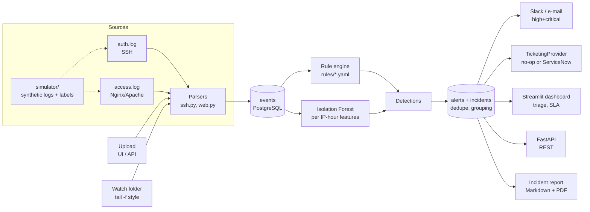

# LogSentinel design

This document explains how LogSentinel is put together and why. It is written so
each decision can be defended (or criticised) in a design review.

## Goals and non-goals

**Goals**

- Show the full analyst loop on a small scale: *collect -> normalise -> detect -> alert -> triage -> report*.
- Detections that are explainable, testable and changeable without code (YAML).
- Honest measurement of how well the detections work.
- Runs anywhere with one command (Docker Compose), and has a public demo.

**Non-goals**

- Replacing a SIEM. There is no distributed storage, no streaming, and no
  multi-tenant access control. Section *Scaling up* describes what would change.
- Real-time sub-second detection. Detection runs in batches (per upload, per
  watch-folder poll, or on demand), which is enough for the log volumes here.

## Architecture

### Components

| Module | Responsibility |
|---|---|
| `parsers/` | Turn raw lines into one `ParsedEvent` shape. SSH: classic and RFC 3339 syslog, `message repeated N times`. Web: combined/common format, IPv6, escaped quotes. |
| `ingest.py` | Bulk insert with `ON CONFLICT DO NOTHING` on a line hash, so re-ingesting a file is harmless. `FolderWatcher` tails files by byte offset. |
| `detection/rules.py` | Generic YAML rule engine: `threshold`, `distinct`, `sequence`. |
| `detection/anomaly.py` | Feature engineering + Isolation Forest. |
| `alerts.py` | Store detections (fingerprint dedupe), group into incidents, triage transitions, SLA maths. |
| `pipeline.py` | Orchestrates one detection run. |
| `notify.py`, `ticketing.py` | Outbound integrations, both optional and failure-tolerant. |
| `servicenow.py`, `ticket_sync.py` | ServiceNow Table API provider; opening/updating tickets after detection and the status-sync job. |
| `report.py` | Jinja2 Markdown report, converted to PDF with fpdf2. |
| `api.py`, `cli.py`, `dashboard/app.py` | Three front doors over the same core functions. |

## Data model

- **events**: one row per log line (or per repeat of a repeated line). Columns are
  the union of what SSH and web logs need (`src_ip`, `username`, `action`, `path`,
  `status`, `user_agent`, ...), plus the untouched `raw` line for evidence.
  *Trade-off:* a single wide table is simple to query and good enough for two log
  types. With ten log types, a narrow core table plus a JSON column (or per-source
  tables) would be better.
- **alerts**: one detection with triage state (`status`, `assignee`,
  `acknowledged_at`, `resolved_at`). `alert_events` links each alert to the
  events that triggered it (capped at 200 per alert) so the analyst sees evidence.
- **incidents**: groups alerts by source entity. Status is *derived* from its alerts.
- **alert_notes**: free-text notes and an automatic audit trail of every status or
  assignee change (who, what, when).

Timestamps are stored as `timestamptz` in UTC. A small `TypeDecorator` makes
SQLite (used in unit tests) behave the same way.

## Detection design

### Why YAML rules

SOC teams tune detections constantly. Keeping thresholds, windows, severities,
MITRE mappings and response steps in YAML means a tuning change is a one-line,
reviewable diff, and a new detection needs no Python. Pydantic validates every
rule at load time, so a typo fails loudly instead of silently disabling a rule.

### Three rule types

| Type | Question it answers | Used by |
|---|---|---|
| `threshold` | "At least N matching events from one source within W?" | SSH-001, SSH-004, WEB-001..005 |
| `distinct` | "At least N *different* values (e.g. usernames) within W?" | SSH-002 |
| `sequence` | "N events of kind A, then one of kind B, within W?" | SSH-003 |

### Bursts: one alert per attack, not per event

Matching events for one source are split into *bursts*: runs where no gap exceeds
the window. A burst becomes an alert if any sliding window inside it reaches the
threshold. So a 2-hour brute-force attack produces **one** alert carrying the full
event count, not 400 alerts. Each alert has a fingerprint
`sha256(rule, entity, first event time)`; running detection again over the same
data finds the same fingerprints and adds nothing.

*Trade-off:* a very long, steady trickle that never has a gap longer than the
window becomes one long alert. That is the right behaviour for scanning, but a
production system would also cap alert duration and roll over to a new alert.

### Anomaly detection

Features per (source IP, hour): event count, busiest-minute rate, web error
ratio, distinct paths, failed-login ratio, distinct usernames, and hour of day as
sin/cos (so 23:00 and 00:00 are neighbours). Counts are log-scaled so one huge
source does not dominate the trees.

Isolation Forest was chosen because it needs **no labels**, trains in
milliseconds on this data, and its output (a score) is easy to rank. Its known
limits, all visible in [EVALUATION.md](EVALUATION.md):

- It finds *unusual*, not *malicious*. A search-engine crawler is unusual and gets flagged.
- `contamination` (expected share of anomalies) decides how many points are
  flagged. Precision and recall trade off directly against it.
- It is retrained on each run's data, so a long-running attack that dominates the
  data can start to look "normal".
- Per-hour aggregation hides attacks that are slow even at the hourly scale (the
  low-and-slow brute force is missed at the default setting).

Anomaly alerts are medium severity with no MITRE technique: they mean "look
here", and the analyst decides what the activity is.

### MITRE ATT&CK mapping

Each rule names one technique (e.g. T1110.003 Password Spraying). This gives
analysts a shared vocabulary, lets reports show which tactics an attacker reached
(Reconnaissance -> Credential Access -> Initial Access), and shows coverage gaps.

## Triage and SLA

- Status flow: `New -> Investigating -> Resolved | False positive` (re-opening is allowed).
- The first status or assignee change sets `acknowledged_at`; closing sets `resolved_at`.
- SLA targets per severity (critical: 15 min / 4 h, high: 30 min / 8 h, medium:
  4 h / 24 h, low: 24 h / 72 h). **Open alerts already past their target count as
  breaches**, so ignoring alerts cannot improve the numbers.
- Incidents group alerts from the same IP or username within 24 h (configurable)
  while the incident is open. The incident's severity is the maximum of its alerts.

## Integrations

- **Notifications** (Slack webhook, SMTP) are configured only through environment
  variables. A failed notification is logged and never blocks detection.
- **Ticketing** is a `TicketingProvider` protocol with `create_incident`,
  `update_incident`, `get_status` and `get_statuses`. The no-op default returns
  `LOCAL-<id>`. The ServiceNow provider uses the Table API
  (`/api/now/table/incident`), stores the `sys_id` in `incidents.external_ref`
  and the number/state/link in `ticket_*` columns. Only High/Critical incidents
  are ticketed; a `correlation_id` makes creation idempotent; a scheduled job
  syncs Resolved/Closed back. Full description, mapping and sequence diagram:
  [README: ServiceNow integration](../README.md#servicenow-integration).

## Security of the tool itself

- Secrets only come from environment variables or Streamlit secrets; `.env` is
  git-ignored; pre-commit and CI run **gitleaks** to stop accidental commits.
- Optional `X-API-Key` on every write endpoint, compared in constant time.
- Upload size is capped (20 MB). Parsers never execute or evaluate log content,
  and the dashboard shows raw lines inside code blocks, not as HTML.
- Containers run as an unprivileged user.
- Demo data uses only reserved documentation/private IP ranges and made-up names.

## Testing strategy

- Unit tests for every parser branch and **every rule with a positive and a
  negative case**. A meta-test fails if a new YAML rule has no test cases.
- Engine tests for YAML validation, condition operators and burst logic.
- An integration test runs the real Alembic migration and the whole pipeline on
  PostgreSQL (CI service container), including `ON CONFLICT` dedupe and
  `timestamptz` round trips.
- The evaluation (`logsentinel evaluate`) is also a regression test: rule recall
  on the simulator data is asserted in CI.

## Scaling up

| Today | At 1000x the volume |
|---|---|
| Batch ingest into one Postgres table | Agents/forwarders (Fluent Bit, Vector) -> a queue (Kafka, Kinesis) -> stream processors; a log store built for search (Elasticsearch/OpenSearch, ClickHouse) with time-partitioned indexes and retention |
| Detection loads events into pandas | Streaming detection (windowed aggregations in Flink/Kafka Streams) or the SIEM's own engine; the same YAML rules could be compiled to Sigma and run in Splunk / Microsoft Sentinel / Elastic |
| One Isolation Forest retrained per run | Models trained offline on a baseline period, versioned, and scored in the stream; per-entity baselines |
| Single-tenant dashboard | SOAR/ITSM (ServiceNow) for case management, SSO + role-based access |

## Known limitations

- Data in the demo is synthetic; real-world accuracy would be lower and needs
  tuning on real logs (the real loghub sample is included to show parsing and
  rules on genuine attack traffic, but it has no labels).
- Classic syslog lines have no year or timezone; LogSentinel assumes UTC and
  infers the year.
- No authentication on the dashboard (it is a public demo); set `READ_ONLY=1` to
  disable changes.
- The default `contamination` (0.02) was picked using the same synthetic data
  that it is evaluated on, which flatters the numbers; it should be re-tuned on
  real traffic.
